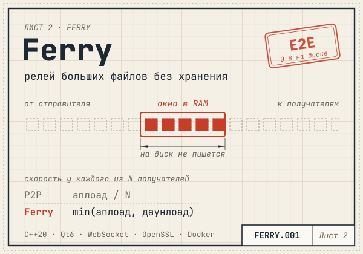
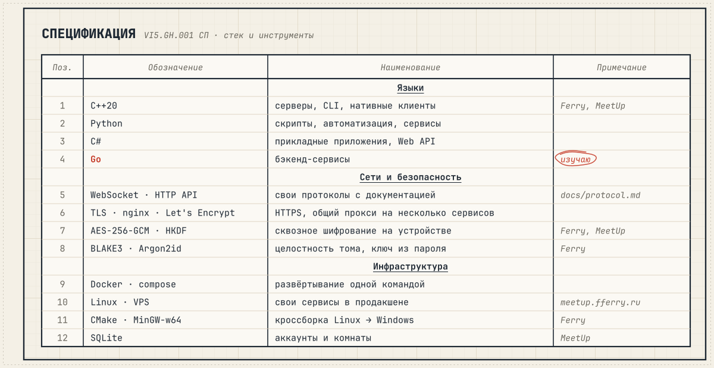

<!--
  Профиль vi5vi5vi5. Картинки в assets/ собирает build.py:
  поправь блок НАСТРОЙКИ в нём и запусти `python build.py`.
  Тема (калька/синька) переключается сама под тему GitHub у зрителя.
-->

  <picture>
    <source media="(prefers-color-scheme: dark)" srcset="assets/header-dark.svg">
    <source media="(prefers-color-scheme: light)" srcset="assets/header-light.svg">
    
  </picture>

Делаю сетевые сервисы на C++ и Python: релеи, видеосвязь, свои протоколы поверх WebSocket. Довожу их до продакшена сам: Docker, nginx, сертификаты, собственный VPS. Сейчас учу Go и иду в бэкенд.

  <a href="https://github.com/vi5vi5vi5/Ferry"><picture>
    <source media="(prefers-color-scheme: dark)" srcset="assets/card-ferry-dark.svg">
    <source media="(prefers-color-scheme: light)" srcset="assets/card-ferry-light.svg">
    
  </picture></a>
  <a href="https://github.com/vi5vi5vi5/MeetUp"><picture>
    <source media="(prefers-color-scheme: dark)" srcset="assets/card-meetup-dark.svg">
    <source media="(prefers-color-scheme: light)" srcset="assets/card-meetup-light.svg">
    
  </picture></a>

**[Ferry](https://github.com/vi5vi5vi5/Ferry)** — релей файлов и папок любого размера. Сервер ничего не пишет на диск и видит только шифротекст, а отправитель отдаёт том один раз, сколько бы ни было получателей.

**[MeetUp](https://github.com/vi5vi5vi5/MeetUp)** — видеозвонки, которые живут на вашем сервере. Сервер-ретранслятор на C++20/Qt6, веб-клиент на WebCodecs и нативный клиент для Windows. Попробовать: **[meetup.fferry.ru](https://meetup.fferry.ru)**.

  <picture>
    <source media="(prefers-color-scheme: dark)" srcset="assets/spec-dark.svg">
    <source media="(prefers-color-scheme: light)" srcset="assets/spec-light.svg">
    
  </picture>

  <a href="https://t.me/vi5vi5vi5">Telegram @vi5vi5vi5</a> · <a href="https://meetup.fferry.ru">демо MeetUp</a>

